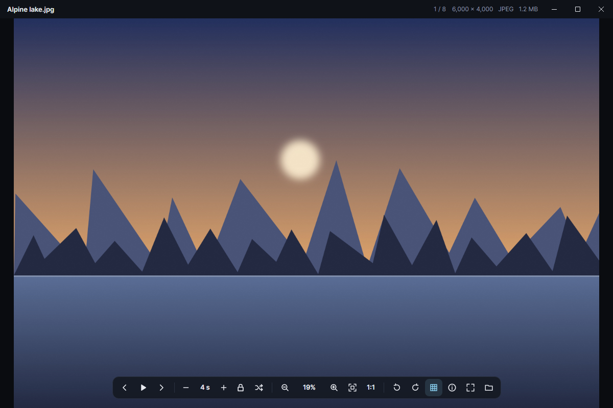
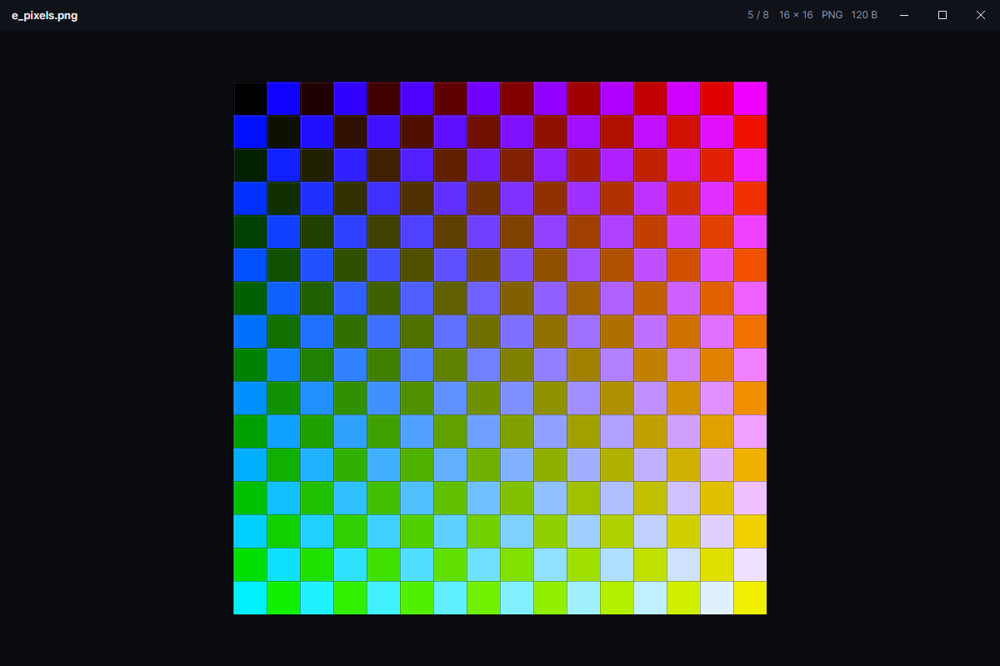

# pxd Image Viewer

A fast, lightweight image viewer for Windows. It zooms from fit-to-window all the way to 51,200%, steps through
every image in the folder, and runs slideshows that can keep your zoom level from one image to the next.

It's a standalone app, and it's also the image viewer built into [pxd Commander](https://github.com/joshpack/pxdCommander).



## Features

- **Deep, high-quality zoom.** Mouse wheel zooms at the cursor, drag to pan, double-click toggles fit ↔ 100%.
  Shrunk images use high-quality filtering; from 400% pixels are drawn as crisp squares, with a pixel grid from 1,200%.
  Only the visible part is sampled, so even 51,200% on a 24-megapixel photo stays smooth.
- **Slideshows** of the whole folder, in Explorer's order (`img2` before `img10`). Speed from 0.5 s to 5 minutes,
  shuffle, loop and cross-fade.
- **Keep zoom** between images (manual stepping and slideshows): the same zoom and the same spot in each picture.
- **Fast:** native build, ready about 0.2 s after launch; the next and previous images are decoded ahead of time.
- **Formats:** JPEG, PNG, GIF and WebP (animated too), BMP, ICO, and through Windows' codecs TIFF, JPEG XR, HEIC,
  AVIF, JPEG XL and camera RAW (as far as the installed codecs allow). Camera photos are turned upright automatically.
- Lossless rotate, full screen, a details panel, drag and drop, and settings that are remembered.



## Keys

| Key | Action |
| --- | --- |
| ← → / Page Up, Page Down | Previous / next image |
| Home / End | First / last image |
| Space or F5 | Start / pause the slideshow |
| `[` / `]` | Slower / faster slideshow |
| K | Keep zoom between images |
| S | Shuffle |
| Wheel, + / − | Zoom |
| 0 / 1 | Fit / 100% |
| Shift + arrows | Pan |
| R / Shift+R | Rotate right / left |
| G | Pixel grid |
| I | Details |
| F or F11 | Full screen |
| Ctrl+O | Open |
| Esc | Leave full screen, stop the slideshow, or close |

## Supported systems

| OS | Status |
| --- | --- |
| Windows 10 / 11 (64-bit) | Supported |
| Linux, macOS | The viewer library builds, but the standalone app is only built and tested for Windows |

## Build

Needs the .NET 10 SDK and, for the native build, Visual Studio's C++ build tools.

```powershell
.\build.ps1    # native single exe in .\dist
```

`pxdImageViewer.exe <image-or-folder> [--slideshow]` opens a file or folder directly.
`--self-test <image> <report.txt>` checks a build without opening a window.
`dotnet run --project tools\Screenshots -c Release -- docs\screenshots` re-renders `viewer.png` headless (Avalonia.Headless, made-up sample images in a temp folder).

## Layout

- `Core/` – the viewer itself (decoding, the zoom canvas, the window). Any Avalonia app can host it.
- `App/` – the standalone app.
